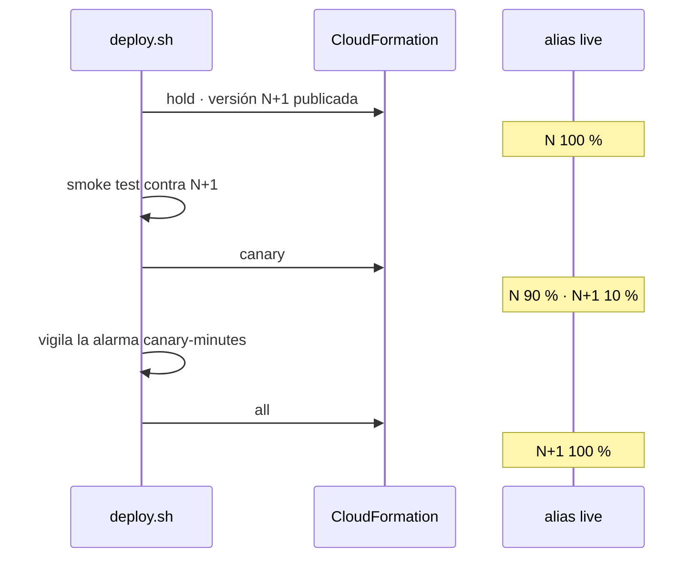

# lamda-cicd-reusable-simplified

Un *reusable workflow* de GitHub Actions que prueba, empaqueta y despliega **una función Lambda en
Python por llamada**, configurada entera desde el `with:`. Con CloudFormation y sin CodeDeploy:
*canary* con los pesos del alias `live`, *reserved concurrency* opcional y exposición opcional
detrás de un listener de ALB o una HTTP API **que ya existen**.

## Uso

[`examples/caller.yml`](examples/caller.yml): CI en cada *pull request*, `dev` en cada push a
`main` y `prod` con canary en cada tag `v*`.

```yaml
jobs:
  hello:
    uses: VanGoMu/lamda-cicd-reusable-simplified/.github/workflows/lambda.yml@v1
    permissions: {contents: read, id-token: write}
    with:
      function-name: lfs-hello
      source-dir: lambdas/hello/src
      tests-dir: lambdas/hello/tests
      smoke-event: lambdas/hello/event.json
      environment: >-
        ${{ github.event_name == 'push'
            && (github.ref_type == 'tag' && 'prod' || 'dev') || '' }}
      canary-percent: ${{ github.ref_type == 'tag' && 10 || 0 }}
```

El job `build` corre siempre y sin credenciales: `ruff check` (con la configuración de ruff del
repositorio que llama, si la tiene), `pytest` y un ZIP reproducible (mismo código, mismos bytes). El job `deploy` solo existe si `environment` no está vacío, corre
dentro de ese GitHub environment (sus reglas de protección y sus variables) y no se solapa con
otro despliegue de la misma función y entorno. La plantilla y los scripts se descargan del commit
exacto al que apunta `@v1`.

| Input | Defecto | Uso |
|---|---|---|
| `function-name` | obligatorio | nombre base: la función y el stack son `<function-name>-<environment>` |
| `source-dir` | obligatorio | raíz del ZIP; un `requirements.txt` junto a ella se instala como wheels de Lambda |
| `tests-dir` | `''` | si existe, `pytest` con `source-dir` en el `PYTHONPATH`; si no, solo `ruff` |
| `handler` | `app.handler` | |
| `runtime` | `python3.13` | también fija el Python del CI |
| `architecture` | `arm64` | `arm64` o `x86_64` |
| `memory` / `timeout` | `128` / `10` | MB / segundos |
| `environment-variables` | `''` | JSON `{"K": "v"}`; nunca secretos, quedan en la plantilla |
| `environment` | `''` | GitHub environment; vacío = solo CI |
| `reserved-concurrency` | `''` | vacío = sin reserva (ver [límites](#límites)) |
| `canary-percent` | `0` | 1–99 activa el canary; 0 = despliegue directo |
| `canary-minutes` | `5` | vigilancia de la alarma, 1–30 |
| `exposure` | `none` | `none`, `alb` o `api-gateway` |
| `alb-listener-arn`, `alb-path`, `alb-priority` | `''` | obligatorios con `alb` (`/hello*`, `110`) |
| `api-id`, `api-route` | `''` | obligatorios con `api-gateway` (`GET /hello`) |
| `smoke-event` | `''` | fichero JSON con el evento; vacío = sin smoke test |
| `smoke-check` | `.statusCode == 200` | expresión `jq -e` sobre la respuesta |

Outputs: `function-arn`, `alias-arn` y `version` (la que sirve el alias al terminar).

## Bootstrap: una vez por entorno

[`bootstrap.yaml`](bootstrap.yaml) crea el bucket de artefactos (privado, cifrado, versionado, solo
TLS), el rol de servicio con el que CloudFormation crea los stacks de funciones y el rol que asume
GitHub por OIDC, que solo puede pedirle a CloudFormation que aplique una plantilla con ese rol.
La configuración completa de AWS y GitHub, paso a paso, con diagramas, comprobaciones y problemas
frecuentes, está en [`docs/manual-setup.md`](docs/manual-setup.md).

```bash
REPO=VanGoMu/lambda-functions ENV=prod

# 1. El `sub` exacto del token de GitHub: el formato (clásico o con IDs inmutables) depende del
#    repositorio, y un `sub` equivocado da «Not authorized to perform AssumeRoleWithWebIdentity».
SUB="$(gh api "repos/${REPO}/actions/oidc/customization/sub" --jq .sub_claim_prefix)"

# 2. La plantilla. CreateOidcProvider=true solo si la cuenta aún no tiene el proveedor de GitHub.
aws cloudformation deploy --stack-name "lambda-cicd-${ENV}" --template-file bootstrap.yaml \
  --capabilities CAPABILITY_IAM --parameter-overrides \
  "GitHubSubject=${SUB}:environment:${ENV}" NamePrefix=lfs- CreateOidcProvider=false
```

`NamePrefix` acota todo lo que el entorno puede tocar: las funciones (y sus stacks) deben empezar
por él. Si el repositorio usa una plantilla de `sub` propia (`use_default: false`), escribe el
`sub` a mano.

Las cuatro variables del GitHub environment son los outputs del stack (su descripción es el nombre
de la variable):

| Variable | Qué es |
|---|---|
| `AWS_REGION` | región de los stacks |
| `AWS_ROLE_ARN` | rol que asume el job `deploy` |
| `CFN_ROLE_ARN` | rol de servicio de CloudFormation |
| `ARTIFACT_BUCKET` | bucket de los ZIP |

```bash
gh api --method PUT "repos/${REPO}/environments/${ENV}" >/dev/null
aws cloudformation describe-stacks --stack-name "lambda-cicd-${ENV}" --query 'Stacks[0].Outputs' \
  | jq -r '.[] | "\(.Description) \(.OutputValue)"' \
  | while read -r name value; do gh variable set "${name}" --env "${ENV}" -R "${REPO}" -b "${value}"; done
```

## Canary

Sin CodeDeploy, así que funciona en cualquier plan de cuenta. El canary son varias
actualizaciones del mismo stack en las que solo cambia el alias `live`
([`scripts/deploy.sh`](scripts/deploy.sh)):



La alarma `<función>-canary-errors` cuenta los `Errors` de la versión nueva a través del alias
(dimensión `ExecutedVersion`), no los de la estable. Se publica versión nueva solo si cambian el
ZIP, la configuración versionada (runtime, handler, arquitectura, memoria, timeout, variables) o la
plantilla; si no, no hay canary. Tampoco en el primer despliegue: no hay versión estable.

| Falla | Alias `live` | Qué hacer |
|---|---|---|
| `hold` (CloudFormation) | N 100 %: el stack se deshace solo | eventos del stack en la consola |
| smoke test contra N+1 | N 100 %: el tráfico no se movió | arreglar y desplegar otra vez |
| `canary` (CloudFormation) | N 100 %: vuelve al `hold` | eventos del stack |
| la alarma salta | N 100 %: `deploy.sh` aplica `hold` | logs de la versión N+1 |
| `all` (CloudFormation) | se queda en N 90 % · N+1 10 % | relanzar el job |
| el runner muere a medias | donde estuviera | el siguiente despliegue parte de N y lo corrige |

Sin canary (`canary-percent: 0`) el smoke test corre contra el alias **después** de mover el
tráfico: marca el job en rojo, pero no vuelve atrás. Volver a una release anterior es desplegar su
tag otra vez (*Re-run* de su ejecución, o `gh workflow run <workflow> --ref vX.Y.Z` si el workflow
declara `workflow_dispatch`): se publica como versión nueva y, en `prod`, pasa por el canary.

## Exposición

El workflow nunca crea el ALB ni la API: añade una ruta a uno que ya existe, que apunta al alias
`live`, así que el canary también reparte el tráfico HTTP.

- **ALB** (`exposure: alb`): el stack crea un target group de tipo `lambda` (sin health check, que
  en Lambda va desactivado por defecto), una regla `path-pattern` en el listener y el permiso de
  invocación para `elasticloadbalancing.amazonaws.com`. La prioridad de la regla es única por
  listener. La respuesta de la función lleva `statusCode`, `headers` y `body`.
- **HTTP API** (`exposure: api-gateway`): solo API Gateway **v2 (HTTP API)**, con un stage
  `$default` en auto-deploy; si no lo tiene, la ruta no se publica sin un `Deployment`. El stack
  crea la integración `AWS_PROXY` (payload 2.0), la ruta y el permiso para el `api-id`. El
  `api-route` (`GET /hello`) es único por API.

## Límites

- **Reserved concurrency**: Lambda exige dejar al menos 100 ejecuciones concurrentes sin reservar
  en la cuenta, y las cuentas nuevas tienen 10 en total: ahí cualquier reserva falla con el error
  de CloudFormation. Si era la creación del stack, queda en `ROLLBACK_COMPLETE` y el siguiente
  despliegue lo borra antes de crearlo otra vez.
- **Alias con pesos**: dos versiones como mucho, publicadas y con el mismo rol de ejecución (el
  stack conserva el rol entre versiones).
- **La alarma solo ve tráfico real** a través del alias: en un entorno sin tráfico, el canary lo
  protege el smoke test. `canary-minutes` llega hasta 30 para no pasar de la hora de credenciales.
- **Las versiones antiguas no se borran** (`UpdateReplacePolicy: Retain` en el recurso `Version`):
  son la vuelta atrás. Límpialas de vez en cuando; tampoco se borra el bucket al quitar el
  bootstrap.
- **Seguridad**: el rol de CloudFormation crea roles de ejecución bajo `/lambda/<NamePrefix>*` con
  la política que diga la plantilla, y cualquier workflow del repositorio que entre en el
  environment obtiene el mismo token. Protege los environments (*required reviewers*, ramas y tags
  permitidos). Las reglas de listener y las rutas de HTTP API no se pueden acotar por nombre: el
  rol alcanza las de toda la cuenta y región. Si dos entornos comparten cuenta y `NamePrefix`, cada
  uno alcanza los recursos del otro: usa cuentas o prefijos distintos.
- **Borrar una función**: quita su job y borra su stack
  (`aws cloudformation delete-stack --stack-name <función>-<entorno> --role-arn <CFN_ROLE_ARN>`).

Fuera de alcance: REST API (v1), crear el ALB o la API, CodeDeploy, SAM, *rollback triggers*,
varias funciones por llamada, *overlays* por entorno, multicuenta, capas, VPC y *provisioned
concurrency*. Para eso está la versión completa,
[lamda-cicd-reusable](https://github.com/VanGoMu/lamda-cicd-reusable).
