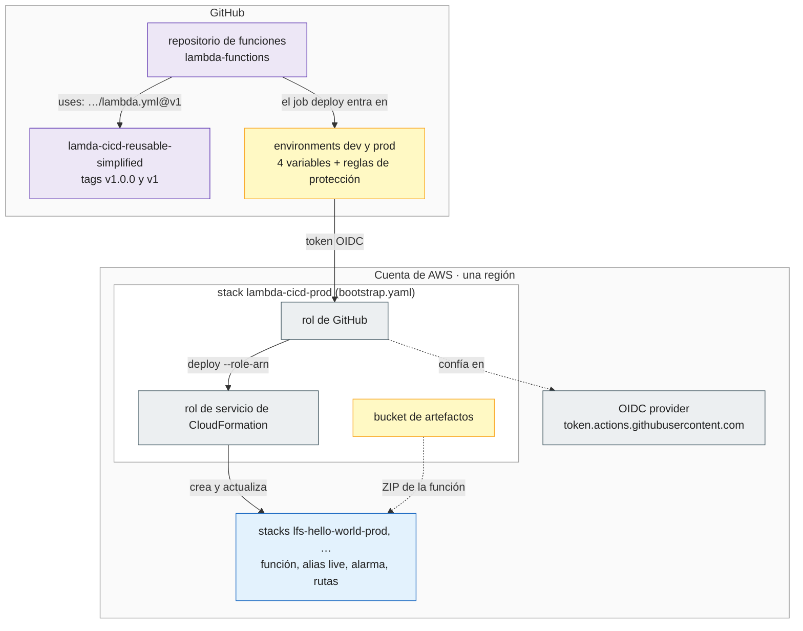
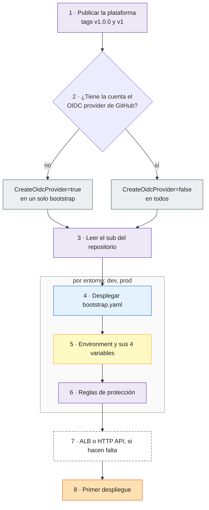
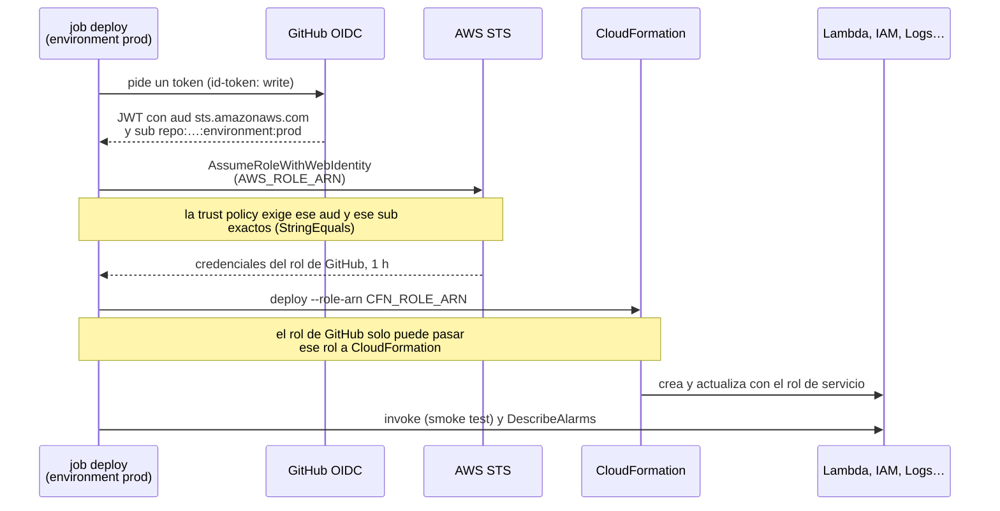
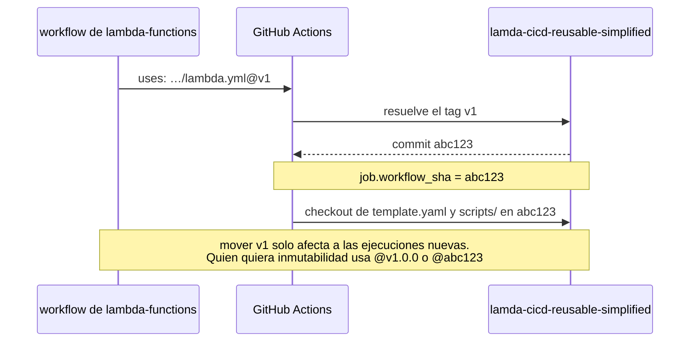
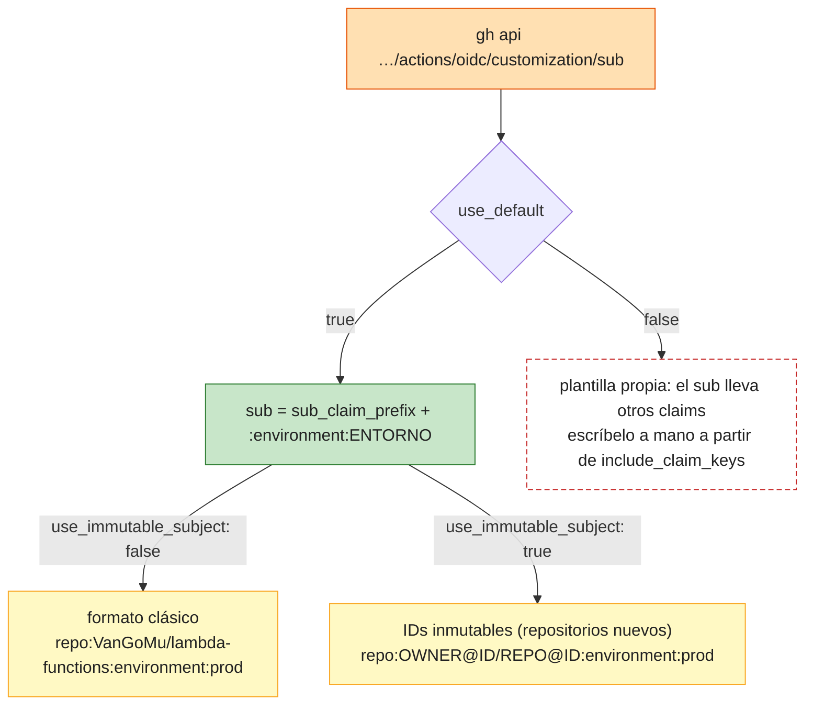
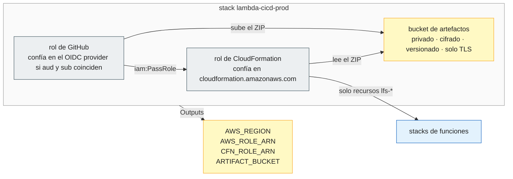
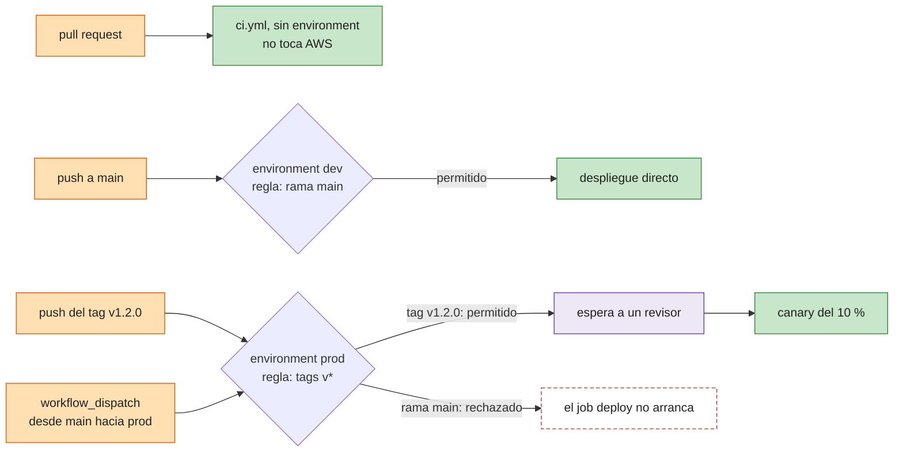
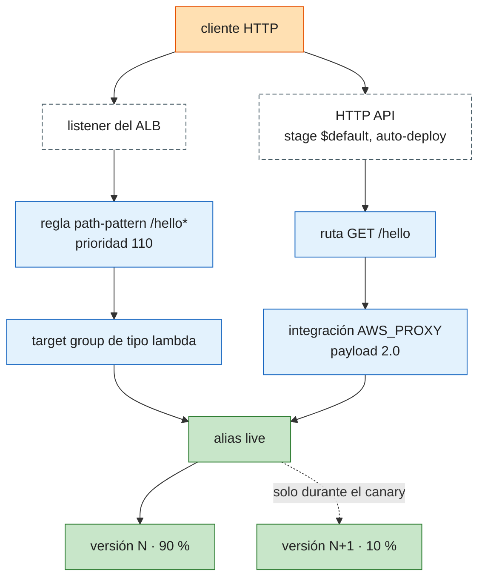
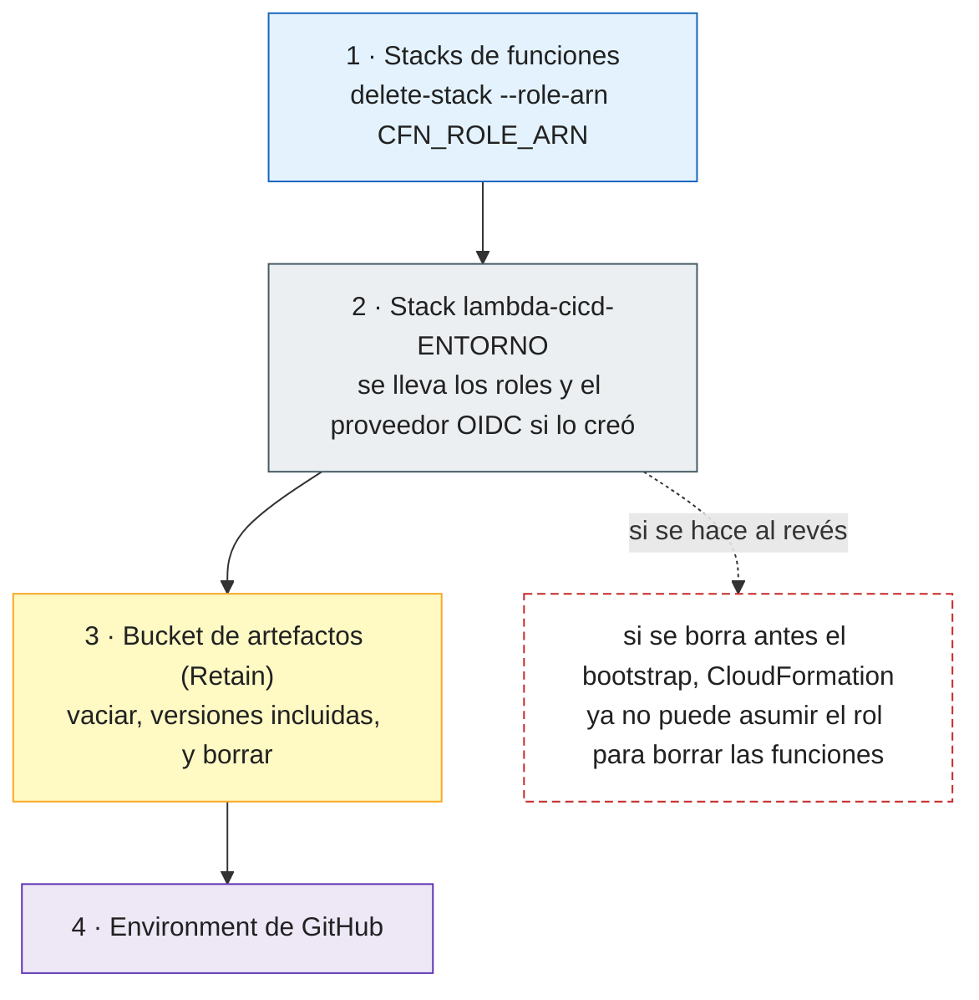

# Configuración manual de AWS y GitHub

Lo que hay que preparar a mano **antes del primer despliegue**. El workflow no crea nada de esto:
solo lo usa. Parte se hace una vez por cuenta, parte una vez por entorno (`dev`, `prod`).

Los ejemplos usan el repositorio de funciones `VanGoMu/lambda-functions`, los entornos `dev` y
`prod` y el prefijo `lfs-`. Cambia esos tres valores por los tuyos.

**Necesitas:**

- AWS CLI v2 con credenciales que puedan crear roles de IAM, un proveedor OIDC, un bucket de S3 y
  stacks de CloudFormation (un administrador de la cuenta, solo para el bootstrap).
- `gh` autenticado con permisos de administración sobre el repositorio de funciones, y `jq`.
- Una región fija: todos los comandos usan la de `aws configure` o `AWS_REGION`.

**Cómo leer los diagramas:**

- 🟧 naranja: quien actúa (tú, un evento de Git, el job).
- 🟪 lila: GitHub.
- ⬜ gris: IAM (roles, proveedor OIDC).
- 🟦 azul: CloudFormation y lo que crea el stack de una función.
- 🟨 amarillo: datos (bucket, variables, outputs).
- 🟩 verde: el resultado esperado.
- Borde discontinuo gris: algo que **ya existe** y no crea nadie aquí. Borde discontinuo rojo: un
  rechazo.

## Vista general

Dos repositorios en GitHub, una cuenta de AWS, y entre ellos un token OIDC: no hay claves de
acceso guardadas en ningún sitio.



| Paso | Dónde | Cuántas veces |
|---|---|---|
| [1 · Publicar la plataforma](#paso-1--publicar-la-plataforma) | GitHub | una por versión |
| [2 · Proveedor OIDC](#paso-2--el-proveedor-oidc-de-github-en-la-cuenta) | AWS | una por cuenta |
| [3 · El `sub` del token](#paso-3--el-sub-del-token) | GitHub | una por repositorio de funciones |
| [4 · Bootstrap](#paso-4--el-bootstrap) | AWS | una por entorno |
| [5 · Environment y variables](#paso-5--el-environment-y-sus-cuatro-variables) | GitHub | una por entorno |
| [6 · Reglas de protección](#paso-6--las-reglas-de-protección) | GitHub | una por entorno |
| [7 · ALB o HTTP API](#paso-7--opcional-el-alb-o-la-http-api) | AWS | solo si se expone la función |
| [8 · Primer despliegue](#paso-8--primer-despliegue-y-comprobación) | los dos | una |



## Cómo se autentica un despliegue

Merece la pena entenderlo antes de configurar nada, porque casi todos los errores de la primera
ejecución están aquí. Hay **dos roles** y ninguno tiene claves:

- El **rol de GitHub** lo asume el job `deploy` con el token OIDC que GitHub emite para ese job.
  Solo puede subir el ZIP al bucket, pedirle a CloudFormation que aplique una plantilla **con el
  rol de servicio**, invocar la función (smoke test) y leer la alarma del canary.
- El **rol de servicio de CloudFormation** es el que crea de verdad la función, su rol de
  ejecución, el log group, la alarma y las rutas. Solo sobre recursos que empiezan por el prefijo.



Consecuencias prácticas:

- Un job que **no** entra en el environment (el CI de una pull request) recibe otro `sub` y no puede
  asumir el rol: el CI nunca toca AWS, aunque quisiera.
- El `sub` de `dev` no vale para `prod`: cada entorno tiene su propio rol.
- La hora de las credenciales limita la duración del despliegue; por eso `canary-minutes` llega
  como mucho a 30.

## Paso 1 · Publicar la plataforma

El repositorio de funciones llama a `lambda.yml@v1`: el tag `v1` tiene que existir. La convención es
un tag inmutable por release (`v1.0.0`) y un tag `v1` que se mueve a la última release compatible.



```bash
cd lamda-cicd-reusable-simplified
git tag v1.0.0 && git push origin v1.0.0
git tag -f v1 v1.0.0 && git push -f origin v1
```

Si el repositorio de funciones limita qué actions puede usar (*Settings → Actions → General*), tiene
que permitir las de GitHub (`actions/*`), `aws-actions/configure-aws-credentials` y el propio
reusable workflow:

```bash
# allowed_actions: all | selected | local_only
gh api repos/VanGoMu/lambda-functions/actions/permissions
```

## Paso 2 · El proveedor OIDC de GitHub en la cuenta

AWS solo acepta tokens de GitHub si la cuenta tiene un *identity provider* para
`token.actions.githubusercontent.com`. Hay **uno por cuenta**, compartido por todos los entornos y
repositorios.

```bash
aws iam list-open-id-connect-providers --output text \
  --query "OpenIDConnectProviderList[?ends_with(Arn, 'token.actions.githubusercontent.com')].Arn"
```

- Devuelve un ARN → `CreateOidcProvider=false` en todos los bootstraps.
- No devuelve nada → `CreateOidcProvider=true` en **uno solo**: el del entorno que vaya a vivir más
  (normalmente `prod`). Si borras ese stack, el proveedor se va con él y los demás entornos dejan de
  autenticar.

## Paso 3 · El `sub` del token

La trust policy del rol de GitHub compara el claim `sub` **exacto**. Su forma depende del
repositorio, y GitHub la dice:

```bash
gh api repos/VanGoMu/lambda-functions/actions/oidc/customization/sub
# {"use_default":true,"use_immutable_subject":false,"sub_claim_prefix":"repo:VanGoMu/lambda-functions"}
```



No lo escribas de memoria: con el formato equivocado, el rol no se puede asumir y el error no dice
por qué. El nombre del entorno del `sub` es el mismo que el del environment de GitHub y el del
`environment:` de la llamada.

## Paso 4 · El bootstrap

[`bootstrap.yaml`](../bootstrap.yaml) se despliega una vez por entorno. Crea el bucket, los dos
roles y, si se le pide, el proveedor OIDC.



| Parámetro | Valor | Para qué |
|---|---|---|
| `GitHubSubject` | el `sub` del paso 3 + `:environment:<entorno>` | quién puede asumir el rol de GitHub |
| `NamePrefix` | `lfs-` | todo `function-name` del entorno tiene que empezar por él |
| `CreateOidcProvider` | `true` o `false` (paso 2) | crear el proveedor OIDC de la cuenta |

```bash
REPO=VanGoMu/lambda-functions
SUB="$(gh api "repos/${REPO}/actions/oidc/customization/sub" --jq .sub_claim_prefix)"

aws cloudformation deploy --stack-name lambda-cicd-prod --template-file bootstrap.yaml \
  --capabilities CAPABILITY_IAM --parameter-overrides \
  "GitHubSubject=${SUB}:environment:prod" NamePrefix=lfs- CreateOidcProvider=true

aws cloudformation deploy --stack-name lambda-cicd-dev --template-file bootstrap.yaml \
  --capabilities CAPABILITY_IAM --parameter-overrides \
  "GitHubSubject=${SUB}:environment:dev" NamePrefix=lfs- CreateOidcProvider=false
```

Comprueba los outputs. La descripción de cada uno es el nombre de la variable que rellena:

```bash
aws cloudformation describe-stacks --stack-name lambda-cicd-prod \
  --query 'Stacks[0].Outputs[].[Description, OutputValue]' --output table
```

> [!WARNING]
> Si `dev` y `prod` comparten cuenta y prefijo, el rol de un entorno alcanza las funciones del otro
> (las dos se llaman `lfs-…`). Para aislarlos de verdad, usa cuentas distintas.

## Paso 5 · El environment y sus cuatro variables

El job `deploy` lee la configuración de AWS de las **variables del environment** (no son secretos:
son ARNs y un nombre de bucket). Crea el environment antes de la primera ejecución: si un workflow
nombra un environment que no existe, GitHub lo crea vacío, sin variables, y el despliegue falla.

```bash
REPO=VanGoMu/lambda-functions
for ENV in dev prod; do
  gh api --method PUT "repos/${REPO}/environments/${ENV}" >/dev/null
  aws cloudformation describe-stacks --stack-name "lambda-cicd-${ENV}" \
    --query 'Stacks[0].Outputs' \
    | jq -r '.[] | "\(.Description) \(.OutputValue)"' \
    | while read -r name value; do
        gh variable set "${name}" --env "${ENV}" -R "${REPO}" -b "${value}"
      done
  gh variable list --env "${ENV}" -R "${REPO}"
done
```

| Variable | Output del bootstrap | La usa |
|---|---|---|
| `AWS_REGION` | `Region` | `configure-aws-credentials` y todos los comandos de `aws` |
| `AWS_ROLE_ARN` | `GitHubRoleArn` | `configure-aws-credentials` (el rol que asume el job) |
| `CFN_ROLE_ARN` | `CloudFormationRoleArn` | `deploy.sh`: `--role-arn` de cada `cloudformation deploy` |
| `ARTIFACT_BUCKET` | `ArtifactBucket` | `deploy.sh`: `cloudformation package` sube ahí el ZIP |

## Paso 6 · Las reglas de protección

Las reglas del environment deciden **desde qué refs** se puede desplegar y **quién aprueba**. Se
evalúan antes de que arranque el job `deploy`, así que con revisores la aprobación llega antes de
tocar AWS (y antes del canary, no entre sus pasos).



```bash
REPO=VanGoMu/lambda-functions

# dev: solo desde main
gh api --method PUT "repos/${REPO}/environments/dev" --input - <<'EOF' >/dev/null
{"deployment_branch_policy": {"protected_branches": false, "custom_branch_policies": true}}
EOF
gh api --method POST "repos/${REPO}/environments/dev/deployment-branch-policies" \
  -f name=main -f type=branch

# prod: solo desde tags v* y con tu aprobación
ID="$(gh api user --jq .id)"
gh api --method PUT "repos/${REPO}/environments/prod" --input - <<EOF >/dev/null
{"reviewers": [{"type": "User", "id": ${ID}}],
 "deployment_branch_policy": {"protected_branches": false, "custom_branch_policies": true}}
EOF
gh api --method POST "repos/${REPO}/environments/prod/deployment-branch-policies" \
  -f name='v*' -f type=tag
```

Las reglas son además la principal defensa del rol de CloudFormation: cualquier workflow que entre
en el environment obtiene el mismo token, y ese rol puede crear roles de ejecución con cualquier
política (ver *Límites* en el [README](../README.md#límites)). En repositorios públicos están en
todos los planes de GitHub; en privados, depende del plan.

## Paso 7 · Opcional: el ALB o la HTTP API

Solo si alguna función usa `exposure: alb` o `exposure: api-gateway`. El workflow **no crea** el ALB
ni la API: hay que darle los identificadores de unos que ya existen, y comprobar que la prioridad o
la ruta están libres.



Lo de borde discontinuo existe ya; lo azul lo crea el stack de la función, junto con el permiso de
invocación del alias para `elasticloadbalancing.amazonaws.com` o `apigateway.amazonaws.com`. Las dos
entradas llegan al alias `live`, así que el canary también reparte el tráfico HTTP.

**ALB** → `alb-listener-arn`, `alb-path`, `alb-priority`:

```bash
aws elbv2 describe-load-balancers --output text \
  --query 'LoadBalancers[].[LoadBalancerName, LoadBalancerArn]'
aws elbv2 describe-listeners --load-balancer-arn <ALB_ARN> --output text \
  --query 'Listeners[].[Port, Protocol, ListenerArn]'
aws elbv2 describe-rules --listener-arn <LISTENER_ARN> --output text \
  --query 'Rules[].Priority'                       # prioridades ocupadas: elige otra
```

**HTTP API** → `api-id`, `api-route`:

```bash
aws apigatewayv2 get-apis --output text \
  --query "Items[?ProtocolType=='HTTP'].[Name, ApiId]"
aws apigatewayv2 get-stages --api-id <API_ID> --output text \
  --query 'Items[].[StageName, AutoDeploy]'        # hace falta $default con True
aws apigatewayv2 get-routes --api-id <API_ID> --output text \
  --query 'Items[].RouteKey'                       # route keys ocupadas: elige otra
```

Sin un stage `$default` en auto-deploy la ruta se crea pero no se publica. Las REST API (v1) no
están soportadas.

## Paso 8 · Primer despliegue y comprobación

```bash
git push origin main                 # en lambda-functions: despliega en dev
gh run watch -R VanGoMu/lambda-functions
```

El resumen del job `deploy` dice la versión, el reparto del tráfico y el resultado del smoke test.
Para verlo en AWS (solo lectura):

```bash
aws cloudformation describe-stacks --stack-name lfs-hello-world-dev \
  --query 'Stacks[0].Outputs[].[OutputKey, OutputValue]' --output table
aws lambda get-alias --function-name lfs-hello-world-dev --name live \
  --query '{version: FunctionVersion, canary: RoutingConfig.AdditionalVersionWeights}'
aws lambda invoke --function-name lfs-hello-world-dev:live \
  --payload fileb://lambdas/hello-world/event.json /dev/stdout
```

El primer despliegue a `prod` (el primer tag `v*`) no hace canary: todavía no hay versión estable que
conservar. A partir del segundo, sí.

## Problemas frecuentes

| Síntoma | Causa probable | Qué hacer |
|---|---|---|
| El workflow no arranca: no encuentra `lambda.yml@v1` | falta el tag `v1` en la plataforma | paso 1 |
| `Not authorized to perform sts:AssumeRoleWithWebIdentity` | el `sub` no coincide: formato (clásico o inmutable) o nombre del entorno | paso 3 y redesplegar el bootstrap |
| El mismo error, en todos los entornos | la cuenta no tiene proveedor OIDC, o se borró con su stack | paso 2 |
| `Credentials could not be loaded` o falta `aws-region` | el environment no tiene las variables (o tiene otro nombre) | paso 5: `gh variable list --env <entorno>` |
| `deploy.sh` termina con `CFN_ROLE_ARN: set by the bootstrap` | falta la variable `CFN_ROLE_ARN` | paso 5 |
| `AccessDenied` en `iam:PassRole` | `CFN_ROLE_ARN` es el rol de otro entorno | paso 5 con el stack correcto |
| Fallo de permisos en los eventos del stack (`lambda:CreateFunction`…) | `function-name` no empieza por `NamePrefix` | renombrar la función o el prefijo |
| El job queda en *Waiting* | el environment pide revisión | aprobar en la ejecución |
| `… is not allowed to deploy to prod due to environment protection rules` | se lanzó desde una rama, no desde un tag `v*` | desplegar el tag |
| Stack en `ROLLBACK_COMPLETE` | falló la creación | nada: el siguiente despliegue lo borra y lo crea |
| Error de `ReservedConcurrentExecutions` | la cuenta no deja 100 ejecuciones sin reservar | quitar `reserved-concurrency` o pedir más cuota |
| `PriorityInUse` en la regla del listener | otra regla tiene esa prioridad | paso 7: otra `alb-priority` |
| `ConflictException` en la ruta | la API ya tiene ese route key | paso 7: otra `api-route` |

## Desmontar

El orden importa: los stacks de funciones se borran **con el rol de servicio** del bootstrap, así
que el bootstrap va al final.



```bash
ENV=prod
CFN_ROLE_ARN="$(aws cloudformation describe-stacks --stack-name "lambda-cicd-${ENV}" \
  --query "Stacks[0].Outputs[?Description=='CFN_ROLE_ARN'].OutputValue" --output text)"
aws cloudformation delete-stack --stack-name "lfs-hello-world-${ENV}" --role-arn "${CFN_ROLE_ARN}"
aws cloudformation wait stack-delete-complete --stack-name "lfs-hello-world-${ENV}"
aws cloudformation delete-stack --stack-name "lambda-cicd-${ENV}"
gh api --method DELETE "repos/VanGoMu/lambda-functions/environments/${ENV}"
```

Borrar el stack de una función borra la función con todas sus versiones. El bucket se conserva
(`DeletionPolicy: Retain`): vacíalo desde la consola de S3 (*Empty* borra también las versiones) y
bórralo después.
