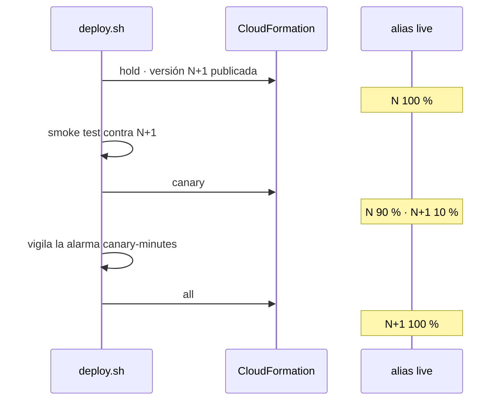

# Prompt · lamda-cicd-reusable-simplified

## Rol

Actúa como ingeniero senior de AWS (Lambda, CloudFormation, IAM) y GitHub Actions. El trabajo
tiene dos partes:

1. Construir un repositorio **público, pequeño y publicable** con un *reusable workflow* que prueba,
   empaqueta y despliega **una función Lambda en Python por llamada**, configurada entera desde los
   `with:` de la llamada.
2. Preparar de nuevo el repositorio de funciones `lambda-functions` para que lo use
   ([Parte 2](#parte-2--preparar-lambda-functions)).

Trabaja solo en estas dos carpetas:

| Carpeta | Estado de partida |
|---|---|
| `/home/epicuro/Desktop/AWS/repositories/lamda-cicd-reusable-simplified` | vacía salvo este prompt; `.git` con remoto `git@github.com:VanGoMu/lamda-cicd-reusable-simplified.git` |
| `/home/epicuro/Desktop/AWS/repositories/lambda-functions` | rama `chore/reusable-simplified`, en el estado original (`c09b1ba`) |

El nombre del repositorio conserva la errata `lamda`; usa `lambda` en todo lo demás.

## Contexto

Existe una versión completa en `../lamda-cicd-reusable` (manifiesto `function.yaml`, librería Python,
toolchains, deployers enchufables, fragmentos, bootstrap con *permissions boundary*, ~90 tests). **No
la copies ni la reproduzcas.** Este repositorio es su contrapunto: lo mínimo que resuelve el caso
común. Puedes consultarla para tomar estas ideas, y solo estas:

- el reusable workflow se descarga a sí mismo con `repository: ${{ job.workflow_repository }}` y
  `ref: ${{ job.workflow_sha }}` para usar su plantilla y sus scripts en la versión exacta fijada;
- el `sub` OIDC de GitHub depende del repositorio (formato clásico o con IDs inmutables) y se lee de
  `gh api repos/<owner>/<repo>/actions/oidc/customization/sub` (`sub_claim_prefix`);
- canary con pesos en el alias (`RoutingConfig`) y alarma de `Errors` con la dimensión
  `ExecutedVersion` (ver `../lamda-cicd-reusable/docs/pills/canary.md`);
- dependencias como wheels para la arquitectura de Lambda (`pip install --platform
  manylinux2014_<arch> --only-binary=:all: --python-version X.Y --target`).

## Lo que no se negocia

- **No crees recursos en AWS** ni ejecutes despliegues; no asumas credenciales válidas.
- **No hagas commit ni push**, no cambies de rama y no toques nada fuera de las dos carpetas.
- No instales herramientas globalmente (usa un virtualenv en el scratchpad, Docker para actionlint).
- Código, nombres y comentarios en inglés; documentación en castellano con los términos técnicos en
  inglés. Bash con `#!/usr/bin/env bash`, `set -euo pipefail`, comillas siempre, 100 columnas.
- Actions de terceros fijadas por SHA con la versión en un comentario (consulta las actuales con
  `gh api repos/<owner>/<action>/releases/latest`).

## Objetivo

Que un repositorio de funciones despliegue así, sin manifiesto ni configuración aparte:

```yaml
jobs:
  hello:
    uses: VanGoMu/lamda-cicd-reusable-simplified/.github/workflows/lambda.yml@v1
    permissions: {contents: read, id-token: write}
    with:
      function-name: lfs-hello
      source-dir: lambdas/hello/src
      tests-dir: lambdas/hello/tests
      handler: app.handler
      environment: prod              # vacío = solo CI, sin AWS
      reserved-concurrency: 5        # vacío = sin reserva
      canary-percent: 10             # 0 = despliegue directo
      canary-minutes: 5
      exposure: alb                  # none | alb | api-gateway
      alb-listener-arn: arn:aws:elasticloadbalancing:…:listener/app/…
      alb-path: /hello*
      alb-priority: 110
```

Tres capacidades, todas desde la llamada:

1. **Canary deployment** con los pesos del alias `live`, sin CodeDeploy (funciona en cualquier
   plan de cuenta).
2. **Reserved concurrency** opcional.
3. **Exposición** detrás de un recurso **que ya existe**: un listener de **ALB**, una **HTTP API**
   de API Gateway, o **ninguno**. El workflow nunca crea el ALB ni la API.

## Reducir el código: presupuesto

Es el criterio principal. Antes de añadir algo, pregúntate si lo resuelve ya la AWS CLI, una
`Condition` de CloudFormation o un `if:` del workflow.

| Fichero | Máximo orientativo |
|---|---|
| `.github/workflows/lambda.yml` | 150 líneas |
| `template.yaml` | 200 líneas |
| `scripts/package.sh` | 40 líneas |
| `scripts/deploy.sh` | 120 líneas |
| `bootstrap.yaml` | 150 líneas |
| `README.md` | 200 líneas |

**Prohibido**: manifiestos, librerías Python propias, composite actions, sistemas de plugins,
varias plantillas, *fake AWS CLI*, frameworks de test para los scripts. **Sí**: inputs del
workflow, una plantilla con `Conditions`, dos scripts y `aws cloudformation package` + `deploy`.

## Arquitectura (ya decidida: impleméntala)

Si encuentras un motivo técnico para desviarte, explícalo en una frase antes de hacerlo.

```text
lamda-cicd-reusable-simplified/
├── .github/workflows/
│   ├── lambda.yml            reusable: jobs build → deploy
│   └── self-test.yml         lint + llamada a lambda.yml solo CI con el ejemplo
├── .github/actionlint.yaml   ignora job.workflow_* (actionlint 1.7.12 aún no las conoce)
├── template.yaml             la función, versión, alias, canary, concurrencia y exposición
├── scripts/
│   ├── package.sh            dependencias + ZIP reproducible
│   └── deploy.sh             package/deploy de CloudFormation, canary, smoke test
├── bootstrap.yaml            rol OIDC, rol de servicio de CloudFormation, bucket
├── examples/
│   ├── caller.yml            workflow de un repositorio consumidor
│   └── hello/{src/app.py,tests/test_app.py,event.json}
├── README.md
└── LICENSE                   MIT
```

### Inputs de `lambda.yml`

| Input | Tipo · defecto | Uso |
|---|---|---|
| `function-name` | string, obligatorio | nombre base; la función y el stack son `<function-name>-<environment>` |
| `source-dir` | string, obligatorio | raíz del ZIP |
| `tests-dir` | string · `''` | si existe, `pytest`; si no, solo lint |
| `handler` | string · `app.handler` | |
| `runtime` | string · `python3.13` | la versión de Python del CI sale de aquí |
| `architecture` | string · `arm64` | |
| `memory` / `timeout` | number · `128` / `10` | |
| `environment-variables` | string · `''` | JSON `{"K":"v"}`, no secretos |
| `environment` | string · `''` | GitHub environment; vacío = no se despliega |
| `reserved-concurrency` | string · `''` | vacío = sin reserva |
| `canary-percent` | number · `0` | 1–99 activa el canary |
| `canary-minutes` | number · `5` | vigilancia de la alarma, máximo 30 |
| `exposure` | string · `none` | `none`, `alb`, `api-gateway` |
| `alb-listener-arn`, `alb-path`, `alb-priority` | string | obligatorios con `alb` |
| `api-id`, `api-route` | string | obligatorios con `api-gateway` (`GET /hello`) |
| `smoke-event` | string · `''` | fichero JSON; vacío = sin smoke test |
| `smoke-check` | string · `.statusCode == 200` | expresión `jq -e` sobre la respuesta |

Outputs: `function-arn`, `alias-arn`, `version`.

Valida en un primer paso, con bash corto, las combinaciones (inputs obligatorios según `exposure`,
rangos de canary). La configuración de AWS viene de variables del GitHub environment del
repositorio que llama: `AWS_REGION`, `AWS_ROLE_ARN`, `CFN_ROLE_ARN`, `ARTIFACT_BUCKET`.

### Jobs

- **`build`** (siempre, sin credenciales): checkout del consumidor y de la plataforma
  (`job.workflow_sha`), `setup-python`, `ruff check` + `pytest` (versiones fijadas en el
  workflow), `scripts/package.sh`, `upload-artifact` del ZIP.
- **`deploy`** (`if: inputs.environment != ''`): `environment: ${{ inputs.environment }}`,
  `concurrency` por función y entorno sin cancelar, OIDC con
  `aws-actions/configure-aws-credentials`, `download-artifact`, `scripts/deploy.sh`. Resumen del
  job con versión, reparto de tráfico y resultado del smoke test.

### `scripts/package.sh`

Copia `source-dir`, instala `requirements.txt` (si existe, junto a `source-dir`) con
`pip --platform/--only-binary/--target`, borra `bin/` y `__pycache__`, fija fechas (`touch -d
@0`) y comprime con la lista ordenada (`find | sort | zip -X -@`). Mismo código → mismo ZIP: el
`aws cloudformation package` siguiente sube a una clave por MD5 y no repite subidas.

### `template.yaml`

Parámetros: los de la función, `VersionHash`, `TrafficMode` (`all` | `hold` | `canary`),
`StableVersion`, `CanaryPercent`, `ReservedConcurrency` (`''` = sin reserva), `Exposure` y los de
cada exposición. `Code` apunta a la ruta local del ZIP, que reescribe `aws cloudformation package`.

| Recurso | Condición | Notas |
|---|---|---|
| `LogGroup`, `ExecutionRole` (solo su log group), `Function` | siempre | `ReservedConcurrentExecutions: !If [HasConcurrency, …, !Ref AWS::NoValue]` |
| `Version` | siempre | `Description: !Ref VersionHash`, `UpdateReplacePolicy: Retain` |
| `Alias` `live` | siempre | `FunctionVersion` = nueva en `all`, `StableVersion` en `hold`/`canary`; `RoutingConfig` solo en `canary` |
| `CanaryAlarm` | `CanaryPercent` ≠ 0 | `Errors` con `FunctionName`, `Resource=<fn>:live`, `ExecutedVersion=<versión nueva>` |
| `TargetGroup` (`TargetType: lambda`, target = alias), `ListenerRule`, `AlbPermission` | `Exposure == alb` | ver avisos |
| `ApiIntegration` (`AWS_PROXY`, payload 2.0, URI = alias), `ApiRoute`, `ApiPermission` | `Exposure == api-gateway` | ver avisos |

Outputs: `FunctionArn`, `AliasArn`, `NewVersion`, `LiveVersion`, `CanaryAlarmName`.

`VersionHash` lo calcula `deploy.sh`: SHA-256 del ZIP más la configuración que versiona Lambda
(runtime, handler, arquitectura, memoria, timeout, variables). Si no cambia, el recurso `Version` no
se reemplaza y no se publica versión; si cambia, se publica una y la anterior sobrevive.

### `scripts/deploy.sh`: el flujo

```text
inyecta environment-variables en Function con yq · aws cloudformation package
stable = LiveVersion del stack (vacío si no existe)
si canary-percent == 0 o stable vacío:
    deploy TrafficMode=all → smoke test contra el alias → fin
si no:
    deploy TrafficMode=hold StableVersion=stable     # publica la versión nueva con 0 % de tráfico
    new = NewVersion; si new == stable → deploy TrafficMode=all (no-op) → fin
    smoke test contra <FunctionArn>:<new>             # falla → salir (el tráfico no se movió)
    deploy TrafficMode=canary CanaryPercent=…
    durante canary-minutes, cada 30 s: estado de CanaryAlarm
        ALARM → deploy TrafficMode=hold → salir con error
    deploy TrafficMode=all → fin
```



Cada paso es `aws cloudformation deploy --role-arn "$CFN_ROLE_ARN" --no-fail-on-empty-changeset
--capabilities CAPABILITY_IAM` con los mismos parámetros salvo los de tráfico, así que entre pasos
solo cambia el alias. No uses *rollback triggers*: la vigilancia por sondeo es más corta de
escribir y no persiste configuración en el stack.

### Avisos que el código y el README tienen que respetar

- **ALB**: el permiso de invocación tiene que existir antes de registrar el target, y con
  `SourceArn` del target group se crea un ciclo. Dale al `TargetGroup` un `Name` explícito (≤ 32
  caracteres: recorta o usa un hash), construye el `SourceArn` del permiso con ese nombre y comodín en
  el id (`…:targetgroup/<name>/*`) y pon `DependsOn: AlbPermission` en el target group. La prioridad
  de la regla es única por listener. Los target groups de Lambda no hacen health check por defecto.
- **API Gateway**: solo **HTTP API (v2)** existente, con un stage **auto-deploy** (`$default`); si no,
  la ruta no se publica sin un `Deployment`. Permiso con `SourceArn`
  `arn:aws:execute-api:<región>:<cuenta>:<api-id>/*/*`. El `route key` es único por API.
- **Alias con pesos**: como mucho dos versiones, publicadas y con el mismo rol de ejecución.
- **Reserved concurrency**: Lambda exige dejar al menos 100 de concurrencia sin reservar en la cuenta;
  las cuentas nuevas tienen un límite total de 10, así que cualquier reserva falla. Documéntalo y deja
  que falle con el error de CloudFormation (o un precheck de tres líneas con
  `aws lambda get-account-settings`, si cabe en el presupuesto).

### `bootstrap.yaml`

Una plantilla por entorno, desplegada a mano (el README da los dos comandos, uno con `gh api` para el
`sub`):

- parámetros: `GitHubSubject` (exacto, `…:environment:<env>`), `NamePrefix` (las funciones deben
  empezar por él), `CreateOidcProvider` (`true` si la cuenta no tiene el de GitHub);
- bucket de artefactos privado, cifrado, versionado, solo TLS;
- rol de servicio de CloudFormation acotado a recursos `<NamePrefix>*`: Lambda, IAM (roles con path
  propio y `iam:PassRole` solo hacia `lambda.amazonaws.com`), Logs, CloudWatch alarms,
  `elasticloadbalancing` (target groups y reglas) y `apigateway` (`/apis/*/routes/*`,
  `/apis/*/integrations/*`);
- rol de GitHub: `cloudformation:*` sobre stacks `<NamePrefix>*`, `iam:PassRole` del rol de servicio,
  subir y leer en el bucket, `lambda:InvokeFunction` y `cloudwatch:DescribeAlarms` sobre lo suyo.

Outputs = las cuatro variables del environment.

## Documentación sintetizada

Un único `README.md`, directo, sin repetir lo que dicen los inputs del workflow:

1. qué hace, en tres líneas;
2. ejemplo de llamada (CI en PR, despliegue en `main` y por tags);
3. tabla de inputs (una línea por input);
4. bootstrap: los dos comandos y las cuatro variables;
5. canary: el diagrama y qué pasa si falla cada paso;
6. exposición: requisitos del ALB y de la HTTP API existentes;
7. límites y lo que queda fuera.

En el código, comentarios solo donde el porqué no es obvio (el ciclo del ALB, el `hold`, el
`VersionHash`).

## Validación

Ejecuta y enseña el resultado real (si una herramienta no está, dilo; no la des por pasada):

```bash
bash -n scripts/*.sh && shellcheck -x scripts/*.sh
cfn-lint template.yaml bootstrap.yaml                 # virtualenv en el scratchpad
docker run --rm -v "$PWD:/repo" -w /repo rhysd/actionlint:1.7.12
./scripts/package.sh … && ./scripts/package.sh …      # sobre examples/hello: mismo SHA-256 dos veces
```

Y un render de la plantilla con cada `Exposure` (`none`, `alb`, `api-gateway`) y con canary activo
y apagado, comprobado con cfn-lint. `self-test.yml` repite el lint y llama a `lambda.yml` sin
`environment` sobre `examples/hello`.

## Fuera de alcance

REST API (v1), crear el ALB o la API, CodeDeploy, SAM, *rollback triggers*, varias funciones por
llamada, overlays por entorno, multicuenta, capas, VPC, provisioned concurrency.

## Parte 2 · Preparar `lambda-functions`

### Punto de partida

- Rama **`chore/reusable-simplified`**, creada a propósito en `c09b1ba`, **un commit por detrás de
  `main`**. Ese commit (`52df136 chore: evolution`, solo en local) adaptó el repositorio a la
  plataforma completa (`function.yaml`, función `heartbeat`, Makefile…); **no se usa aquí**. No
  toques `main`. Puedes leer de él con `git show main:<ruta>` para recuperar código que sirva tal
  cual, sobre todo `lambdas/hello-world/src/app.py` y `lambdas/hello-world/tests/test_app.py`.
- En la rama hay lo original: `scripts/{deploy,invoke,undeploy}.sh` (despliegue manual con la AWS
  CLI) y `lambdas/hello-world/{lambda_function.py,config.env,event.json,README.md}`.
- Quedan carpetas `__pycache__` ignoradas de la versión anterior (`lambdas/heartbeat/`,
  `lambdas/hello-world/{src,tests}/`): bórralas antes de empezar.

### Qué tiene que quedar

```text
lambda-functions/
├── .github/workflows/
│   ├── ci.yml        pull requests: un job por función → lambda.yml sin environment
│   └── deploy.yml    main → dev · tags v* → prod (canary) · manual (workflow_dispatch)
├── lambdas/hello-world/
│   ├── src/app.py
│   ├── tests/test_app.py
│   ├── event.json    evento del smoke test
│   └── README.md
├── README.md
└── LICENSE           el que hay
```

- Fuera `scripts/`, `config.env` y `lambda_function.py`: su papel lo hacen ahora los inputs del
  workflow. Sin manifiestos, Makefile ni `function.yaml`.
- `deploy.yml` llama a `VanGoMu/lamda-cicd-reusable-simplified/.github/workflows/lambda.yml@v1`
  una vez por función y entorno. `hello-world`: en `dev` despliegue directo, en `prod`
  `canary-percent: 10`, `canary-minutes: 5`, smoke test con `event.json`, `exposure: none` y sin
  reserved concurrency (las cuentas nuevas no pueden reservar). El nombre de la función empieza por
  el `NamePrefix` del bootstrap (`lfs-hello-world`).
- Las variantes `alb` y `api-gateway` y `reserved-concurrency` aparecen en el README de
  `lambda-functions` como bloques `with:` de ejemplo, no en los workflows: no hay ALB ni API
  existentes que referenciar.
- Añadir una función = copiar su carpeta y un bloque de job; dilo así en el README.

### Documentación de `lambda-functions`

`README.md` corto: qué hay, cómo se despliega (PR → CI, `main` → dev, tag → prod en canary), cómo
añadir una función, los dos environments con sus cuatro variables (enlazando al bootstrap del repo
simplificado) y cómo volver a una release anterior (`gh workflow run deploy.yml --ref vX.Y.Z -f
environment=prod`). El README de `hello-world`, cinco líneas.

### Validación de la parte 2

- `ruff check` y `pytest` de `hello-world` con los mismos comandos y versiones que usa `lambda.yml`.
- actionlint sobre `.github/workflows/` de `lambda-functions`.
- `git status` en `chore/reusable-simplified`: solo los cambios esperados, sin restos.

## Entrega

Al terminar, en pocas líneas y para cada repositorio: ficheros creados o borrados (con el número de
líneas frente al presupuesto en el simplificado), validaciones ejecutadas y resultado, pasos manuales
en AWS y GitHub (bootstrap, environments, tag `v1` del simplificado antes de que `lambda-functions`
pueda llamarlo) y riesgos o decisiones que el usuario deba revisar antes de publicar.
